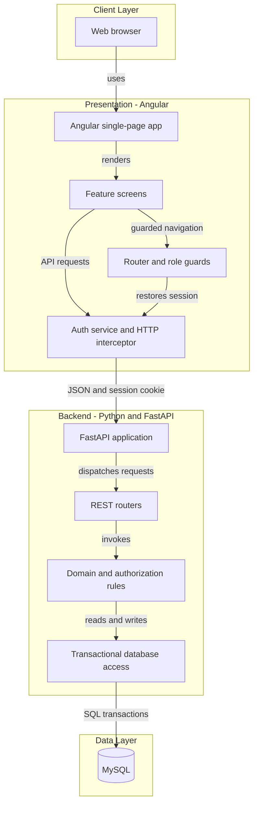

# Architecture Diagram

Autos Colombia is a web application for parking operations, with role-based access for operators and administrators. Its Angular single-page application communicates with a FastAPI backend that centralizes business rules and persists operational data in MySQL.

## Application Architecture

<!-- mermaid-checked: no \n, no em-dash/en-dash, no {} in labels, subgraphs are id["label"], arrows are -->|"label"|, all subgraphs closed by end, ids unique -->

### Technology Stack Summary

| Layer | Technology | Version | Purpose |
|---|---|---|---|
| Client | Web browser | Not specified | Runs the parking application UI. |
| Frontend | Angular | `^22.2.0` | Standalone SPA, feature screens and routing. |
| Frontend language | TypeScript | `~6.0.2` | Typed frontend implementation. |
| Frontend HTTP | Angular HttpClient and RxJS | RxJS `~7.8.0` | Calls the API and handles asynchronous responses. |
| Backend | Python and FastAPI | Not pinned in requirements | REST API and request validation. |
| Backend server | Uvicorn standard | Not pinned in requirements | ASGI server for the FastAPI application. |
| Database access | MySQL Connector/Python | Not pinned in requirements | Connects to MySQL and executes transactions. |
| Data storage | MySQL with InnoDB | Version not specified | Relational persistence for users, parking operations and payments. |

### Data Storage & External Services

MySQL is the application's only configured persistent data store. The backend uses explicit transaction scopes for operations that update related records, such as a payment, contract validity and receipt. No cache, message broker or external API integration was identified in the inspected configuration and source.

### Key Architectural Decisions

- The backend is a monolithic FastAPI application that registers domain routers from one application entry point.
- Angular feature components call the backend through credentialed HTTP requests; session and role state are used to protect navigation and operations.
- Shared MySQL transactions coordinate persistence and rollback for multi-record business operations.

## Component Relationships

```mermaid
flowchart LR
    subgraph cUiLayer["Presentation"]
        cLogin["Login component"]
        cCash["Cash component"]
        cContracts["Contracts and audit components"]
        cParking["Parking component"]
        cCells["Cells component"]
        cPayments["Payments component"]
        cUsers["Users component"]
        cAuthClient["Auth service and guards"]
        cHttpCore["HTTP interceptor and messages"]
    end
    subgraph cApiLayer["API Routers"]
        cApp["FastAPI app"]
        cAuthRoute["Auth router"]
        cCashRoute["Cash router"]
        cCustomerRoute["Customer router"]
        cContractRoute["Contract router"]
        cTransitRoute["Transit router"]
        cCellRoute["Cell router"]
        cPaymentRoute["Payment and receipt routers"]
        cUserRoute["User router"]
    end
    subgraph cLogicLayer["Business Logic"]
        cAuthLogic["Session and role validation"]
        cCashLogic["Cash rules"]
        cContractLogic["Contract lifecycle rules"]
        cDomainLogic["Domain and vehicle rules"]
        cPaymentLogic["Payment and renewal rules"]
        cReceiptLogic["Receipt numbering"]
        cNoveltyLogic["Transit novelties"]
        cDatabase["Transaction manager"]
    end
    subgraph cDataLayer["Data Access"]
        cMySQL[("MySQL")]
    end

    cLogin -->|"login and logout"| cAuthClient
    cAuthClient -->|"session requests"| cHttpCore
    cCash -->|"cash operations"| cHttpCore
    cContracts -->|"customers and contracts"| cHttpCore
    cParking -->|"transit and contract queries"| cHttpCore
    cCells -->|"cell queries and updates"| cHttpCore
    cPayments -->|"payment operations"| cHttpCore
    cUsers -->|"account operations"| cHttpCore
    cHttpCore -->|"credentialed API calls"| cApp

    cApp -->|"registers"| cAuthRoute
    cApp -->|"registers"| cCashRoute
    cApp -->|"registers"| cCustomerRoute
    cApp -->|"registers"| cContractRoute
    cApp -->|"registers"| cTransitRoute
    cApp -->|"registers"| cCellRoute
    cApp -->|"registers"| cPaymentRoute
    cApp -->|"registers"| cUserRoute

    cAuthRoute -->|"authenticates"| cAuthLogic
    cCashRoute -->|"uses"| cAuthLogic
    cCashRoute -->|"checks open cash"| cCashLogic
    cCustomerRoute -->|"checks session"| cAuthLogic
    cContractRoute -->|"checks access"| cAuthLogic
    cContractRoute -->|"updates contracts"| cContractLogic
    cContractRoute -->|"validates plates"| cDomainLogic
    cTransitRoute -->|"checks access"| cAuthLogic
    cTransitRoute -->|"checks cash"| cCashLogic
    cTransitRoute -->|"validates access and cells"| cDomainLogic
    cTransitRoute -->|"marks contracts expired"| cContractLogic
    cTransitRoute -->|"records novelties"| cNoveltyLogic
    cCellRoute -->|"checks access"| cAuthLogic
    cCellRoute -->|"filters compatible cells"| cDomainLogic
    cPaymentRoute -->|"checks access and cash"| cAuthLogic
    cPaymentRoute -->|"uses open cash"| cCashLogic
    cPaymentRoute -->|"registers payments"| cPaymentLogic
    cPaymentRoute -->|"marks contracts expired"| cContractLogic
    cUserRoute -->|"checks administrator role"| cAuthLogic

    cAuthRoute -->|"queries sessions"| cDatabase
    cCashRoute -->|"queries cash"| cDatabase
    cCustomerRoute -->|"customer queries"| cDatabase
    cContractRoute -->|"contract queries"| cDatabase
    cTransitRoute -->|"transit transactions"| cDatabase
    cCellRoute -->|"cell queries and updates"| cDatabase
    cPaymentRoute -->|"payment transactions and voids"| cDatabase
    cUserRoute -->|"account queries"| cDatabase

    cAuthLogic -->|"database operations"| cDatabase
    cCashLogic -->|"database operations"| cDatabase
    cContractLogic -->|"database operations"| cDatabase
    cPaymentLogic -->|"database operations"| cDatabase
    cPaymentLogic -->|"date and tax rules"| cDomainLogic
    cPaymentLogic -->|"marks expired contracts"| cContractLogic
    cPaymentLogic -->|"requests next number"| cReceiptLogic
    cReceiptLogic -->|"database operations"| cDatabase
    cNoveltyLogic -->|"database operations"| cDatabase
    cDatabase -->|"SQL transactions"| cMySQL
```

<!-- mermaid-checked: no \n, no em-dash/en-dash, no {} in labels, subgraphs are id["label"], arrows are -->|"label"|, all subgraphs closed by end, ids unique -->

### Component Inventory

| Component | Layer | Type | Responsibility |
|---|---|---|---|
| Login component | Presentation | Angular component | Starts and ends user sessions. |
| Cash component | Presentation | Angular component | Opens, views and closes an operator cash register. |
| Contracts and audit components | Presentation | Angular components | Create contracts, change plates and review cancellation records. |
| Parking component | Presentation | Angular component | Records vehicle entries and exits. |
| Cells component | Presentation | Angular component | Displays cell state and supports authorized maintenance changes. |
| Payments component | Presentation | Angular component | Registers monthly payments, presents receipts and requests authorized voids. |
| Users component | Presentation | Angular component | Supports administrator account creation and listing. |
| Auth service and guards | Presentation | Angular service and guards | Maintains current-user state and protects routes by session and role. |
| HTTP interceptor and messages | Presentation | Angular interceptor and services | Sends API calls with credentials and presents common success and error messages. |
| FastAPI app | API | Application entry point | Creates the API and registers routers. |
| Auth router | API | REST router | Handles login, logout and session restoration. |
| Cash router | API | REST router | Opens, queries and closes cash registers. |
| Customer router | API | REST router | Creates and lists customers. |
| Contract router | API | REST router | Creates, lists, changes plates, cancels and audits contracts. |
| Transit router | API | REST router | Coordinates entry and exit operations. |
| Cell router | API | REST router | Queries cells and changes permitted maintenance states. |
| Payment and receipt routers | API | REST routers | Registers and voids payments and returns receipts. |
| User router | API | REST router | Creates and lists accounts for administrators. |
| Session and role validation | Business logic | Authentication module | Validates sessions, roles and administrator credentials. |
| Cash rules | Business logic | Domain module | Finds and requires the operator's open cash register. |
| Contract and plate rules | Business logic | Domain modules | Enforces contract lifecycle, expiry and plate validation. |
| Domain and vehicle rules | Business logic | Domain modules | Validates access, dates, plates and cell compatibility. |
| Transit orchestration | API | Transit router | Coordinates transit state, cell assignment and novelty persistence. |
| Payment and renewal rules | Business logic | Domain module | Persists payment and calculates contract period dates and taxes. |
| Receipt numbering | Business logic | Domain module | Allocates unique consecutive receipt numbers. |
| Transit novelties | Business logic | Domain module | Records damage and exceptional-access novelties. |
| Transaction manager | Data access | Database module | Opens connections and commits or rolls back MySQL transactions. |
| MySQL | Data access | Relational database | Stores users, customers, vehicles, contracts, cash, payments, receipts, cells and transits. |
