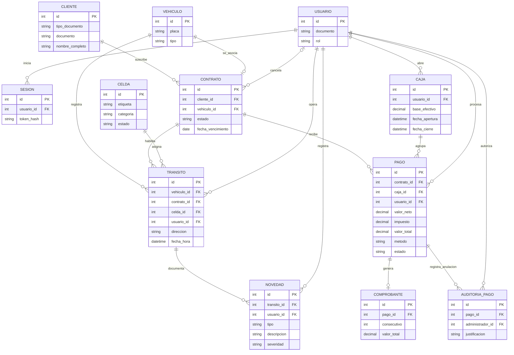

# Modelos de datos - Autos Colombia

Este documento presenta el modelo entidad-relación (MER), el modelo relacional (MR) y el modelo físico de datos del sistema. El MR y el modelo físico describen la implementación actual definida en [`db/schema.sql`](../db/schema.sql); el MER representa las entidades y reglas documentadas en la especificación. Las tres vistas también están disponibles en [modelos-de-datos.puml](./modelos-de-datos.puml) para visualizarlas con la extensión PlantUML de VS Code.

## 1. Modelo entidad-relación (MER)

### Entidades

- **Usuario**: persona con rol Operario o Administrador.
- **Sesión**: sesión de autenticación de un usuario.
- **Cliente**: titular de un contrato.
- **Vehículo**: vehículo identificado por placa y tipo.
- **Contrato**: mensualidad de un cliente para un vehículo.
- **Celda**: espacio de parqueo con categoría fija y estado Libre, Ocupado o En mantenimiento.
- **Caja**: apertura de caja realizada por un usuario.
- **Tránsito**: evento de entrada o salida de un vehículo.
- **Novedad**: daño físico o acceso excepcional asociado a un tránsito.
- **Pago**: pago de un contrato realizado por un usuario durante una apertura de caja.
- **Comprobante**: comprobante consecutivo emitido por un pago.
- **Auditoría de pago**: justificación de una anulación de pago realizada por un administrador.

### Relaciones y cardinalidades

- Un usuario puede tener ninguna o muchas sesiones; cada sesión pertenece a un usuario.
- Un cliente puede tener ninguno o muchos contratos; cada contrato pertenece a un cliente.
- Cada contrato corresponde a un vehículo y cada vehículo se asocia como máximo a un contrato según la especificación; véase la diferencia con el esquema físico en la sección 3.
- Un usuario puede abrir ninguna o muchas cajas; cada caja tiene un usuario titular.
- Un vehículo, contrato, celda y usuario pueden aparecer en ninguno o muchos tránsitos; cada tránsito referencia exactamente uno de cada uno.
- Un tránsito puede tener ninguna o muchas novedades; cada novedad pertenece a un tránsito y la registra un usuario.
- Un contrato, caja y usuario pueden estar asociados a ninguno o muchos pagos; cada pago referencia exactamente un contrato, una caja y un usuario.
- Un pago puede tener cero o un comprobante; cada comprobante referencia un pago.
- Un pago y un administrador pueden estar asociados a ninguna o muchas auditorías; cada auditoría referencia exactamente un pago y un usuario administrador.
- Una cancelación conserva en el contrato el administrador que la realizó, la fecha y la justificación; la consulta de auditoría reúne esos datos con el cliente y el vehículo.

<!-- mermaid-checked: every attribute is `<type> <name> [<key>] ["<description>"]` with at most one of PK/FK/UK, no \n in descriptions, no {} in descriptions, every relationship label is double-quoted -->


## 2. Modelo relacional (MR)

Notación: `PK` = clave primaria, `FK` = clave foránea y `UK` = valor único. Los campos marcados `?` aceptan nulo. Los tipos y dominios exactos se especifican en el modelo físico.

```text
USERS(
  id PK, document UK, password_hash, role, created_at
)

USER_SESSIONS(
  id PK, user_id FK -> USERS.id, token_hash UK, created_at, revoked_at?
)

CUSTOMERS(
  id PK, document_type, document UK, full_name, created_at
)

VEHICLES(
  id PK, plate UK, vehicle_type, created_at
)

CONTRACTS(
  id PK, customer_id FK -> CUSTOMERS.id,
  vehicle_id FK -> VEHICLES.id, status, expires_on?,
  cancelled_by? FK -> USERS.id, cancellation_justification?,
  cancelled_at?, created_at
)

CELLS(
  id PK, label UK, category, status
)

CASH_OPENINGS(
  id PK, user_id FK -> USERS.id, base_amount, opened_at, closed_at?
)

TRANSITS(
  id PK, vehicle_id FK -> VEHICLES.id,
  contract_id FK -> CONTRACTS.id, cell_id FK -> CELLS.id,
  operator_id FK -> USERS.id, direction, occurred_at
)

NOVELTIES(
  id PK, transit_id FK -> TRANSITS.id,
  recorded_by FK -> USERS.id, novelty_type, damage_type?,
  description, severity?, created_at
)

PAYMENTS(
  id PK, contract_id FK -> CONTRACTS.id,
  cash_opening_id FK -> CASH_OPENINGS.id,
  operator_id FK -> USERS.id, net_amount, tax_amount,
  total_amount, paid_months, payment_method, reference_code?,
  status, created_at
)

RECEIPT_COUNTERS(
  id PK, last_number
)

RECEIPTS(
  id PK, payment_id UK FK -> PAYMENTS.id,
  consecutive_number UK, customer_document_type,
  customer_document, customer_full_name, net_amount,
  tax_amount, total_amount, issued_at
)

PAYMENT_AUDIT(
  id PK, payment_id FK -> PAYMENTS.id,
  administrator_id FK -> USERS.id, justification, created_at
)
```

## 3. Modelo físico

El modelo físico vigente es el DDL de [`db/schema.sql`](../db/schema.sql). Se implementa en **MySQL**, con tablas **InnoDB**, juego de caracteres `utf8mb4` y colación `utf8mb4_unicode_ci`. Los identificadores principales son `AUTO_INCREMENT` salvo `receipt_counters.id`; los importes utilizan `DECIMAL(12,2)` y las fechas se almacenan como `DATE` o `DATETIME(6)` según el campo.

### Tablas, tipos y restricciones físicas

| Tabla | Columnas (tipo y restricciones relevantes) |
|---|---|
| `users` | `id BIGINT UNSIGNED PK AUTO_INCREMENT`; `document VARCHAR(30) NOT NULL UNIQUE`; `password_hash VARCHAR(255) NOT NULL`; `role ENUM('Operario','Administrador') NOT NULL`; `created_at DATETIME(6) NOT NULL DEFAULT CURRENT_TIMESTAMP(6)` |
| `user_sessions` | `id BIGINT UNSIGNED PK AUTO_INCREMENT`; `user_id BIGINT UNSIGNED NOT NULL FK`; `token_hash CHAR(64) NOT NULL UNIQUE`; `created_at DATETIME(6) NOT NULL DEFAULT CURRENT_TIMESTAMP(6)`; `revoked_at DATETIME(6) NULL` |
| `customers` | `id BIGINT UNSIGNED PK AUTO_INCREMENT`; `document_type ENUM('CC','CE','NIT') NOT NULL`; `document VARCHAR(30) NOT NULL UNIQUE`; `full_name VARCHAR(160) NOT NULL`; `created_at DATETIME(6) NOT NULL DEFAULT CURRENT_TIMESTAMP(6)` |
| `vehicles` | `id BIGINT UNSIGNED PK AUTO_INCREMENT`; `plate VARCHAR(6) NOT NULL UNIQUE`; `vehicle_type ENUM('Carro','Moto','Camioneta') NOT NULL`; `created_at DATETIME(6) NOT NULL DEFAULT CURRENT_TIMESTAMP(6)` |
| `contracts` | `id BIGINT UNSIGNED PK AUTO_INCREMENT`; `customer_id BIGINT UNSIGNED NOT NULL FK`; `vehicle_id BIGINT UNSIGNED NOT NULL FK`; `status ENUM('Pendiente de Pago','Activo','Vencido','Cancelado') NOT NULL DEFAULT 'Pendiente de Pago'`; `expires_on DATE NULL`; `cancelled_by BIGINT UNSIGNED NULL FK`; `cancellation_justification VARCHAR(1000) NULL`; `cancelled_at DATETIME(6) NULL`; `created_at DATETIME(6) NOT NULL DEFAULT CURRENT_TIMESTAMP(6)` |
| `cells` | `id BIGINT UNSIGNED PK AUTO_INCREMENT`; `label VARCHAR(30) NOT NULL UNIQUE`; `category ENUM('Carro','Moto','Camioneta','Discapacitado') NOT NULL`; `status ENUM('Libre','Ocupado','En mantenimiento') NOT NULL DEFAULT 'Libre'` |
| `cash_openings` | `id BIGINT UNSIGNED PK AUTO_INCREMENT`; `user_id BIGINT UNSIGNED NOT NULL FK`; `base_amount DECIMAL(12,2) NOT NULL`; `opened_at DATETIME(6) NOT NULL DEFAULT CURRENT_TIMESTAMP(6)`; `closed_at DATETIME(6) NULL` |
| `transits` | `id BIGINT UNSIGNED PK AUTO_INCREMENT`; `vehicle_id`, `contract_id`, `cell_id`, `operator_id BIGINT UNSIGNED NOT NULL FK`; `direction ENUM('Entrada','Salida') NOT NULL`; `occurred_at DATETIME(6) NOT NULL DEFAULT CURRENT_TIMESTAMP(6)` |
| `novelties` | `id BIGINT UNSIGNED PK AUTO_INCREMENT`; `transit_id BIGINT UNSIGNED NOT NULL FK`; `novelty_type ENUM('Daño físico','Acceso excepcional') NOT NULL`; `damage_type ENUM('Golpe','Rayón','Falla') NULL`; `description VARCHAR(1000) NOT NULL`; `severity ENUM('Leve','Moderada','Grave') NULL`; `recorded_by BIGINT UNSIGNED NOT NULL FK`; `created_at DATETIME(6) NOT NULL DEFAULT CURRENT_TIMESTAMP(6)` |
| `payments` | `id BIGINT UNSIGNED PK AUTO_INCREMENT`; `contract_id`, `cash_opening_id`, `operator_id BIGINT UNSIGNED NOT NULL FK`; `net_amount`, `tax_amount`, `total_amount DECIMAL(12,2) NOT NULL`; `paid_months INT UNSIGNED NOT NULL`; `payment_method ENUM('Efectivo','Transferencia Bancaria','Tarjeta Crédito/Débito') NOT NULL`; `reference_code VARCHAR(120) NULL`; `status ENUM('Registrado','Anulado') NOT NULL DEFAULT 'Registrado'`; `created_at DATETIME(6) NOT NULL DEFAULT CURRENT_TIMESTAMP(6)` |
| `receipt_counters` | `id TINYINT UNSIGNED PK`; `last_number BIGINT UNSIGNED NOT NULL`; se inicializa con la fila `(1, 0)` |
| `receipts` | `id BIGINT UNSIGNED PK AUTO_INCREMENT`; `payment_id BIGINT UNSIGNED NOT NULL UNIQUE FK`; `consecutive_number BIGINT UNSIGNED NOT NULL UNIQUE`; `customer_document_type ENUM('CC','CE','NIT') NOT NULL`; `customer_document VARCHAR(30) NOT NULL`; `customer_full_name VARCHAR(160) NOT NULL`; `net_amount`, `tax_amount`, `total_amount DECIMAL(12,2) NOT NULL`; `issued_at DATETIME(6) NOT NULL DEFAULT CURRENT_TIMESTAMP(6)` |
| `payment_audit` | `id BIGINT UNSIGNED PK AUTO_INCREMENT`; `payment_id`, `administrator_id BIGINT UNSIGNED NOT NULL FK`; `justification VARCHAR(1000) NOT NULL`; `created_at DATETIME(6) NOT NULL DEFAULT CURRENT_TIMESTAMP(6)` |

### Índices y reglas implementadas en la base de datos

- Índices no únicos: `contracts(vehicle_id, created_at)`, `cash_openings(user_id, closed_at)`, `transits(vehicle_id, occurred_at, id)`, `novelties(transit_id)` y `payments(contract_id, created_at)`.
- Las claves foráneas y restricciones `UNIQUE` se indican en la tabla anterior y en el DDL.
- Triggers impiden actualizar o eliminar tránsitos, actualizar o eliminar novedades, y eliminar pagos.
- Triggers validan los campos requeridos para novedades físicas o de acceso excepcional, y validan que el pago tenga valor y meses positivos y que las transferencias tengan referencia.
- La aplicación cambia las celdas Libre/Ocupado de forma transaccional con los tránsitos. Solo un Administrador puede cambiar Libre/En mantenimiento y la API rechaza cambios manuales sobre celdas ocupadas.
- Anti-Passback se determina por el último tránsito del vehículo, compartido por cualquier contrato que lo referencie; la placa ya dentro conserva su celda hasta que se registre su salida. No hay cambio de esquema para esta regla.
- Las cuentas se crean mediante la API con contraseña hasheada; las consultas de usuarios solo devuelven documento, rol y fecha de creación.
- La auditoría de cancelaciones consulta los campos `cancelled_by`, `cancelled_at` y `cancellation_justification` de `contracts`; no crea una tabla de auditoría adicional.
- La conexión de la aplicación inicia transacciones explícitas y usa `COMMIT` o `ROLLBACK`; el detalle de ejecución está en `backend/app/database.py`.

### Diferencias entre el modelo documentado y el esquema actual

Cada contrato se vincula a un vehículo identificado por una placa única, pero la especificación no exige que el vehículo tenga un único contrato. `contracts.vehicle_id` tiene una clave foránea no única: el DDL permite varios contratos para el mismo vehículo. La relación efectiva es un vehículo con cero o muchos contratos y todos comparten su último tránsito para aplicar Anti-Passback.

`receipts` conserva una instantánea de los datos del cliente y no tiene una clave foránea a `customers`. `receipt_counters` es una tabla técnica para asignar consecutivos y no tiene relación declarada por clave foránea con `receipts`.

## Archivos fuente

- Esquema físico inicial: [`db/schema.sql`](../db/schema.sql).
- Migración para bases creadas con una versión anterior del esquema: [`db/migrations/001_contract_status_lifecycle.sql`](../db/migrations/001_contract_status_lifecycle.sql).
- Migración para añadir el estado En mantenimiento y renombrar estados de celda existentes: [`db/migrations/002_cell_status_maintenance.sql`](../db/migrations/002_cell_status_maintenance.sql).
- Especificación de entidades y requisitos: [`specs/001-parking-operations/spec.md`](../specs/001-parking-operations/spec.md).
